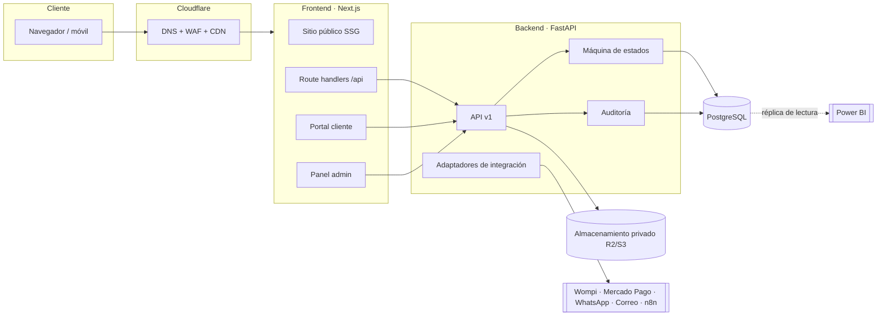
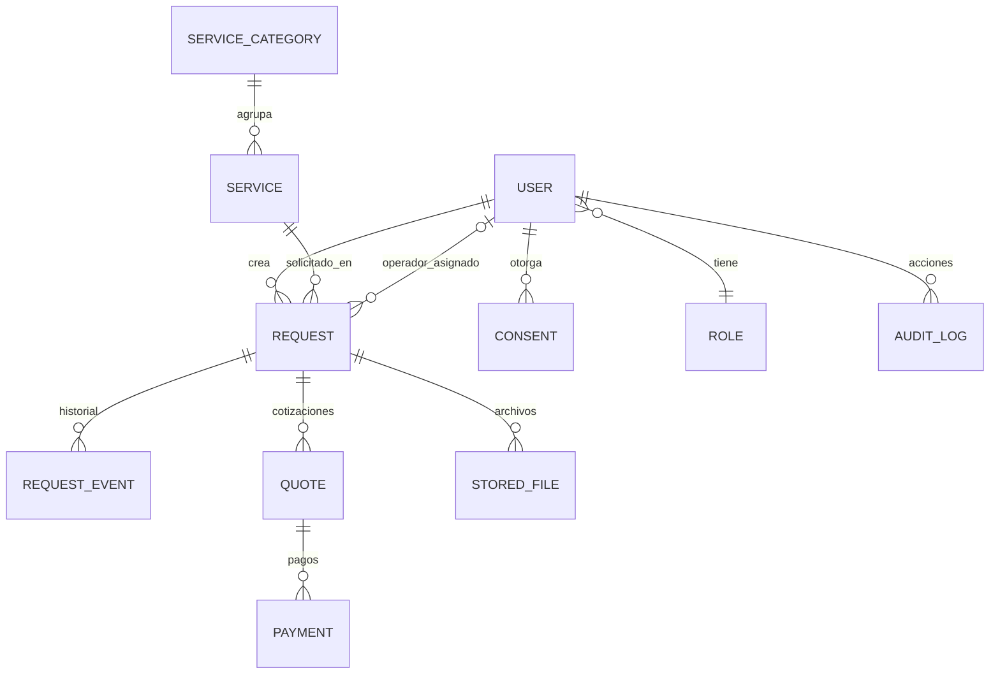
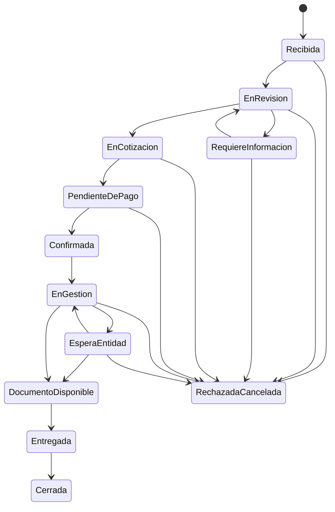

# NEXODOC · Arquitectura de la plataforma

> "Conectamos personas, documentos y soluciones."

Este documento define cómo está construida NEXODOC hoy (fase 1) y cómo crece hasta ser una plataforma nacional de gestión documental sin reescribir lo ya hecho.

---

## 1. Análisis del proyecto

### Qué es NEXODOC

Una empresa privada e independiente que **intermedia y gestiona** solicitudes documentales ante notarías, oficinas de registro, Registraduría, cámaras de comercio, Cancillería, organismos de tránsito, despachos judiciales e instituciones educativas, y que además ofrece **gestión documental empresarial** como servicio propio.

### Qué NO es (y la plataforma debe dejarlo claro)

- No es una entidad pública ni un canal oficial.
- No expide documentos: los expide la entidad responsable.
- No garantiza tiempos de expedición: depende de cada entidad.
- No es un despacho de abogados: el apoyo es documental.

Estas cuatro reglas son restricciones de producto, de copy y de SEO. Por eso cada servicio muestra **entidad responsable, requisitos y condiciones**, y ninguna página promete "expedición inmediata".

### Usuarios y necesidades

| Segmento | Necesidad principal | Lo que la plataforma le da |
|---|---|---|
| Personas naturales | Un documento puntual sin hacer filas | Buscador, solicitud guiada, cotización clara, seguimiento |
| Compradores / vendedores de vivienda | Certificado de tradición, escrituras, paz y salvos | Paquetes inmobiliarios y estudio documental |
| Colombianos en el exterior | Registros civiles, apostillas, poderes | Gestión remota de punta a punta |
| Abogados y oficinas jurídicas | Copias, consultas y certificados recurrentes | Cuenta empresarial, solicitudes masivas |
| Inmobiliarias y constructoras | Volumen alto de certificados por inmueble | Carga masiva, expedientes por proyecto |
| Empresas | Organizar y custodiar su archivo | Gestión documental empresarial y digitalización |

### Riesgos que condicionan el diseño técnico

1. **Datos personales sensibles** (cédulas, registros civiles, antecedentes): Ley 1581 de 2012 y Decreto 1074 de 2015 (compila el Decreto 1377 de 2013).
2. **Documentos de terceros**: nunca en enlaces públicos; acceso por rol y por expediente.
3. **Dependencia de entidades externas**: los estados deben reflejar honestamente "en espera de la entidad".
4. **Pagos**: el cobro es en dos partes (derechos de la entidad + honorario de gestión), siempre cotizado antes.

---

## 2. Fases de producto

| Fase | Alcance | Estado en este repositorio |
|---|---|---|
| **1. Sitio público y captación** | Landing, catálogo, 10 páginas de categoría, buscador, formulario de solicitud, SEO, páginas legales | **Construida** (`frontend/`) |
| **2. Portal del cliente** | Registro, inicio de sesión, recuperación, perfil, solicitudes, carga de archivos, seguimiento, historial, pagos, descargas | Rutas reservadas y API base (`backend/`) |
| **3. Panel administrativo** | Dashboard, clientes, solicitudes, servicios, cotizaciones, pagos, operadores, documentos, notificaciones, reportes, auditoría | Modelo de datos, roles y máquina de estados listos |
| **4. Integraciones** | Wompi, Mercado Pago, WhatsApp Business, n8n, correo transaccional, Power BI | Interfaces definidas, **desactivadas** hasta configurarse |

Nada de la fase 2–4 se simula en la interfaz: si el backend no está configurado, el formulario lo dice y ofrece el canal alterno.

---

## 3. Vista general



**Separación estricta de responsabilidades**

- `frontend/` — presentación, SEO y validación de experiencia. Nunca guarda documentos ni secretos.
- `backend/` — reglas de negocio, autenticación, autorización, estados, archivos y auditoría.
- Base de datos — sólo accesible desde el backend (red privada).
- Integraciones — adaptadores aislados detrás de una interfaz; se activan por variable de entorno.

---

## 4. Estructura del repositorio

```
nexodoc/
├── docs/
│   ├── ARCHITECTURE.md        ← este documento
│   └── DESIGN_SYSTEM.md       ← tokens, tipografía, componentes, motion
├── frontend/                  ← Next.js 15 · React 19 · TypeScript · Tailwind · Motion
│   ├── public/                ← favicon, imagen OG
│   └── src/
│       ├── app/               ← rutas (App Router)
│       ├── components/
│       │   ├── layout/        ← Navbar, Footer
│       │   ├── sections/      ← secciones de la landing
│       │   ├── ui/            ← Button, Reveal, Counter, Accordion…
│       │   ├── icons/         ← iconografía SVG propia
│       │   ├── illustrations/ ← ilustración del hero, mapa de Colombia
│       │   └── forms/         ← formulario de solicitud
│       └── lib/               ← datos, búsqueda, validación, SEO, configuración
└── backend/                   ← FastAPI · SQLAlchemy 2 · PostgreSQL
    └── app/
        ├── core/              ← configuración, seguridad, base de datos
        ├── domain/            ← máquina de estados (sin dependencias)
        ├── models/            ← entidades ORM
        ├── schemas/           ← contratos Pydantic
        ├── services/          ← auditoría, archivos, integraciones
        └── api/v1/            ← endpoints
```

---

## 5. Mapa de rutas del frontend

### Sitio público (fase 1, generado estáticamente)

| Ruta | Propósito |
|---|---|
| `/` | Landing completa |
| `/servicios` | Catálogo de las 10 categorías |
| `/servicios/[categoria]` | Página individual por categoría (10, SSG) |
| `/solicitar` | Solicitud guiada en 3 pasos (acepta `?servicio=`) |
| `/legal/[documento]` | Privacidad, tratamiento de datos, términos, devoluciones |
| `/sitemap.xml`, `/robots.txt` | SEO técnico |

### Portal del cliente (fase 2) — prefijo `/portal`

`/portal/ingresar` · `/portal/registro` · `/portal/recuperar` · `/portal` (resumen) · `/portal/solicitudes` · `/portal/solicitudes/[id]` · `/portal/pagos` · `/portal/documentos` · `/portal/perfil`

### Panel administrativo (fase 3) — prefijo `/admin`, sin indexar

`/admin` (dashboard) · `/admin/solicitudes` · `/admin/clientes` · `/admin/servicios` · `/admin/cotizaciones` · `/admin/pagos` · `/admin/operadores` · `/admin/documentos` · `/admin/notificaciones` · `/admin/reportes` · `/admin/auditoria`

`/portal` y `/admin` se excluyen en `robots.txt` y llevan `noindex`.

---

## 6. API del backend (v1)

| Método y ruta | Rol mínimo | Descripción |
|---|---|---|
| `GET /health` | público | Estado del servicio |
| `GET /v1/catalog/categories` | público | Categorías y servicios activos |
| `POST /v1/requests` | público | Crear solicitud (con consentimiento) desde el sitio |
| `POST /v1/auth/register` | público | Registro de cliente |
| `POST /v1/auth/login` | público | Inicio de sesión (cookies httpOnly) |
| `POST /v1/auth/refresh` · `/logout` | cliente | Rotación y cierre de sesión |
| `GET /v1/me/requests` | cliente | Solicitudes propias |
| `GET /v1/me/requests/{id}` | cliente | Detalle e historial de estados |
| `POST /v1/me/requests/{id}/files` | cliente | Carga validada de archivos |
| `GET /v1/me/documents/{id}/download` | cliente | URL firmada de corta duración |
| `PATCH /v1/admin/requests/{id}/status` | operador | Transición de estado validada |
| `POST /v1/admin/requests/{id}/quote` | operador | Emitir cotización |
| `GET /v1/admin/audit` | admin | Consulta de auditoría |

Contrato completo: `GET /docs` (OpenAPI) en entornos no productivos.

---

## 7. Modelo de datos



- **REQUEST** guarda `code` público (`ND-2026-000123`), estado actual, servicio, solicitante, operador y datos del formulario (`details`, JSONB).
- **REQUEST_EVENT** es el historial inmutable de transiciones (quién, cuándo, desde, hacia, nota visible o interna).
- **QUOTE** separa `entity_fees` (derechos de la entidad) y `service_fee` (honorario NEXODOC) más IVA del honorario.
- **STORED_FILE** guarda sólo metadatos y la clave del objeto en el almacenamiento privado, más su `sha256`.
- **CONSENT** registra versión de la política aceptada, fecha, IP y finalidad (prueba de autorización, art. 9 Ley 1581).
- **AUDIT_LOG** es de sólo inserción.

---

## 8. Estados de una solicitud



La tabla de transiciones vive en `backend/app/domain/request_status.py`, sin dependencias externas, con pruebas en `backend/tests/`. El frontend usa las mismas etiquetas (`frontend/src/lib/data/statuses.ts`).

---

## 9. Seguridad y protección de datos

| Control | Implementación |
|---|---|
| Contraseñas | Argon2id (passlib). Nunca en texto plano ni en logs |
| Sesiones | JWT de acceso de 15 min + refresh rotativo, ambos en cookies `httpOnly`, `Secure`, `SameSite=Lax` |
| Roles | `client`, `operator`, `supervisor`, `admin`; autorización por rol **y** por propiedad del expediente |
| Cifrado en tránsito | TLS 1.2+ (Cloudflare Full Strict), HSTS |
| Cifrado en reposo | Cifrado del proveedor en BD y bucket + cifrado de campo para número de documento de identidad |
| Archivos | Lista blanca (PDF, JPG, PNG), detección de tipo por firma binaria, máx. 10 MB, nombre aleatorio, `sha256`, bucket privado |
| Descargas | URL firmada de 5 minutos, registrada en auditoría |
| Auditoría | Toda lectura de documento y cambio de estado queda en `audit_log` |
| Consentimiento | Casilla explícita no premarcada + versión de política almacenada |
| Retención | Documentos de clientes se eliminan a los 180 días de cerrada la solicitud (configurable); metadatos según obligación legal |
| Cabeceras | CSP, `X-Frame-Options: DENY`, `Referrer-Policy`, `Permissions-Policy` (en `next.config.mjs`) |
| Abuso | Rate limiting en Cloudflare + honeypot en formularios |

Derechos del titular (conocer, actualizar, rectificar, suprimir, revocar): canal dedicado indicado en la Política de Tratamiento, respuesta en los plazos de los arts. 14 y 15 de la Ley 1581.

---

## 10. Integraciones (desactivadas por defecto)

Cada integración es un adaptador con interfaz común y bandera de entorno. Si la bandera está apagada, el sistema **no** muestra la opción al usuario.

| Integración | Uso | Variable |
|---|---|---|
| Wompi | Pago de cotizaciones (PSE, tarjetas, Nequi) | `WOMPI_ENABLED` |
| Mercado Pago | Pasarela alterna | `MERCADOPAGO_ENABLED` |
| WhatsApp Business (Cloud API) | Notificaciones de cambio de estado | `WHATSAPP_ENABLED` |
| Correo transaccional | Confirmaciones, cotizaciones, recuperación | `EMAIL_PROVIDER` |
| n8n | Automatizaciones vía webhooks firmados | `N8N_WEBHOOK_URL` |
| Power BI | Reportes sobre réplica de lectura o vistas | Conexión de solo lectura |

Los webhooks entrantes de pasarelas se verifican por firma antes de cambiar un pago.

---

## 11. Infraestructura recomendada

| Pieza | Opción de arranque (bajo costo) | Opción de escala |
|---|---|---|
| DNS, WAF, CDN | Cloudflare (plan gratuito) | Cloudflare Pro |
| Frontend | Vercel Hobby o Cloudflare Pages | Vercel Pro |
| Backend | Render / Railway / Fly.io (contenedor) | Contenedores con autoescalado |
| PostgreSQL | Neon o Supabase (gestionado) | PostgreSQL gestionado con PITR |
| Archivos | Cloudflare R2 (bucket privado) | R2 con replicación |
| Copias de seguridad | Diarias automáticas + exportación semanal cifrada | PITR 30 días |

---

## 12. SEO

- Páginas públicas generadas estáticamente (SSG) con metadatos únicos por ruta.
- `sitemap.xml` y `robots.txt` generados desde los mismos datos del catálogo, para no duplicar páginas.
- JSON-LD: `Organization` y `WebSite` en el layout; `Service` + `BreadcrumbList` por categoría; `FAQPage` en la landing.
- URLs en español y sin parámetros (`/servicios/inmobiliarios-registrales`).
- Palabras clave trabajadas en contenido real de cada categoría, sin promesas de inmediatez.
